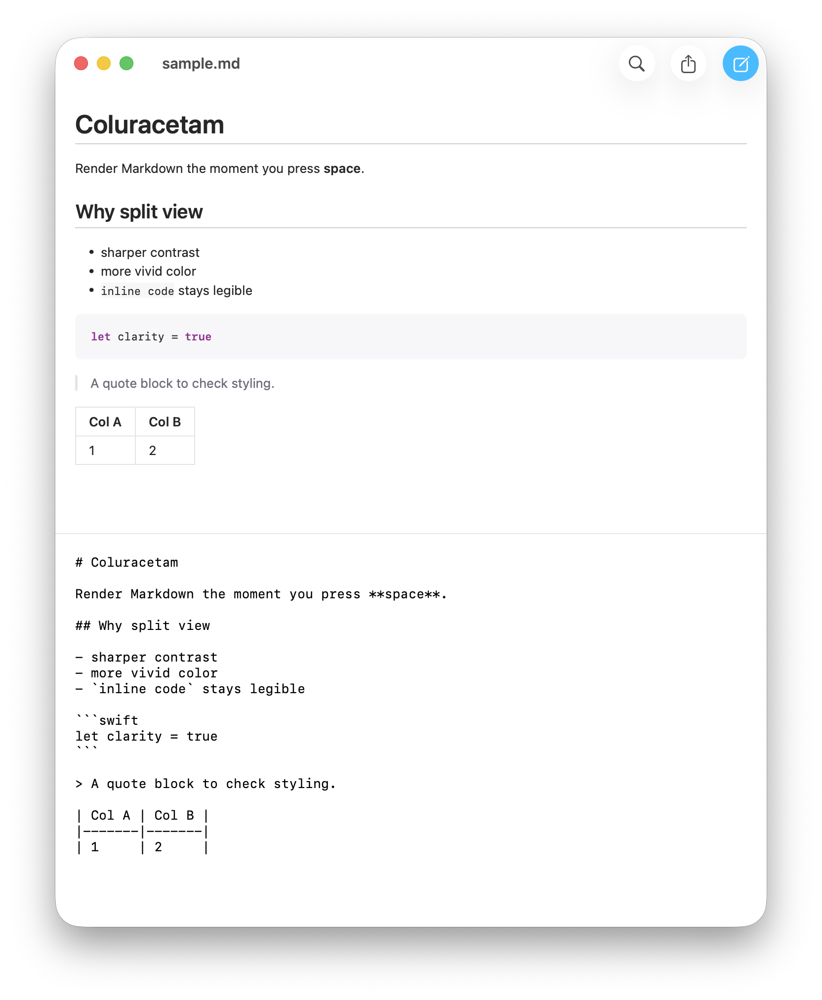

# Coluracetam

Coluracetam brings the same Markdown preview to Finder’s spacebar and a live split editor, with document-wide selection and search. It also generates file thumbnails and exports PDF and HTML.

## Highlights

- Read the same Markdown preview in Finder’s Quick Look and the app’s split editor.
- Select and search across the rendered document.
- Keep unsaved edits when files change in another editor.

Full feature list

- Finder Quick Look with the spacebar, plus generated file thumbnails.
- Live source/preview split with document-wide text selection and search.
- PDF and HTML export.
- Ordinary UTF-8 `.md` and `.markdown` files, with light and dark previews.
- Zoom with **⌘+**, **⌘−**, and **⌘0**.
- External-file reloads that preserve unsaved edits.

## Notes

- macOS 26+.
- Homebrew: `brew install --cask kageroumado/tap/coluracetam`.
- [Rendering reference](REFERENCE.md) · [ColuracetamKit](coluracetam-kit/README.md).
